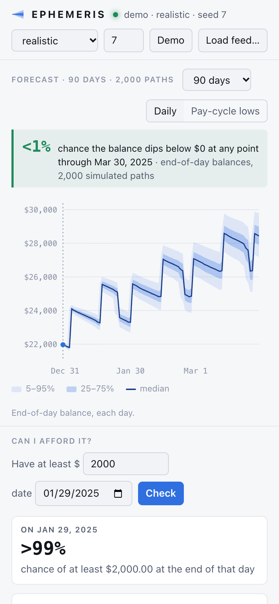

# EPHEMERIS

A personal financial trajectory engine. It estimates your true financial state
with a Kalman filter and projects it forward as a Monte Carlo probability cone,
not a single number. One Rust core, shipped to iOS, Android, Web, and Desktop.

Status: Phase 1 (core engine, CLI) complete; Phase 2 (web, via WASM) in
progress. Full spec: docs/spec.html

*The web app on the Plaid sandbox feed. That feed is Plaid's synthetic test
data with a fake, static balance, so the 47% chance of going below $0 shows
what the feature looks like, not anything about a real account.*

## Screenshots

Taken with `node scripts/screenshots.mjs --build`. "Demo" is the engine's
own synthetic generator (realistic mode, seed 7); "sandbox" is the Plaid
sandbox feed, synthetic test data with a fake static balance. Neither is a
real account, and the risk figures only demonstrate the feature.

*Demo data: a synthetic account that stays well above $0, with the
payday-and-rent sawtooth.*

*Sandbox data, pay-cycle lows view, light mode. The hatched cycles at each
end are partial.*

  
  

*At 390px phone width: demo data in light mode (daily view) and sandbox data
in dark mode (pay-cycle lows).*

## Known gaps

Phase 1 is done, with these gaps stated plainly. Details and measurements
are in docs/phase1-design.md and docs/sandbox-comparison.md.

- **The spend rate is floored at $0/day in the forecast.** The filter's `c`
  is Gaussian, so a wide estimate reaches below zero (the Plaid sandbox
  after its regime changes: ±2σ −$5 to $139/day). The forecast samples `c`
  truncated at $0 and reports that range instead ($8.94 to $139.59). A
  user whose discretionary flow really is a net inflow is mis-forecast;
  `ForecastConfig::spend_floor = None` restores the plain Gaussian.
  Measurements: docs/phase1-design.md §7.
- **Irregular income is not income.** Income is the largest *regular*
  inflow, found by fitting a pay schedule. Gig income, commissions, or a
  one-off wages deposit are treated as unexplained inflows (lumps), so the
  forecast has no paychecks for them. One primary income stream only.
- **The first week after a regime change is overconfident.** The change
  detector needs a run of evidence (median 9 days to flag a doubling of
  spending on model-matched data). Until it fires, the cone is narrow
  around the old spend rate: 44% coverage of the 90% interval one week
  after a doubling. A halving of spending is found slowly, and a pay cut
  only at the second short paycheck.
- **Real-data validation is thin.** The only real-shaped data is one Plaid
  sandbox item: one checking account, a perfectly flat weekly payroll, two
  monthly streams, static balances (so the reconstructed balance history is
  fictional), and no pending→posted links. Everything else is validated on
  the synthetic generator, which shares the author's assumptions.
