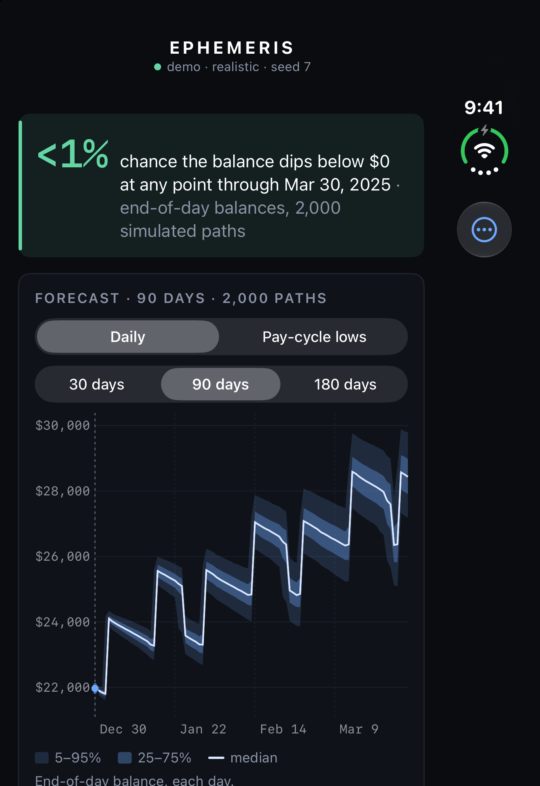
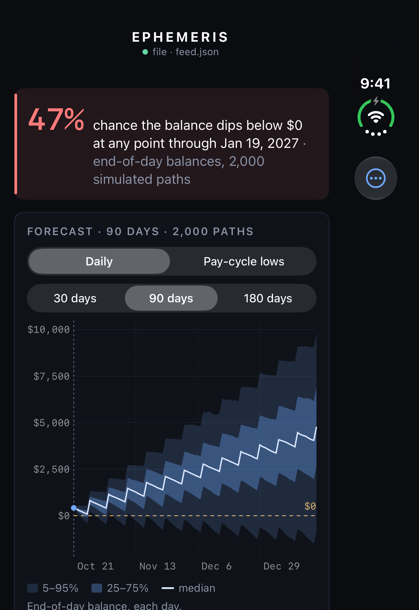
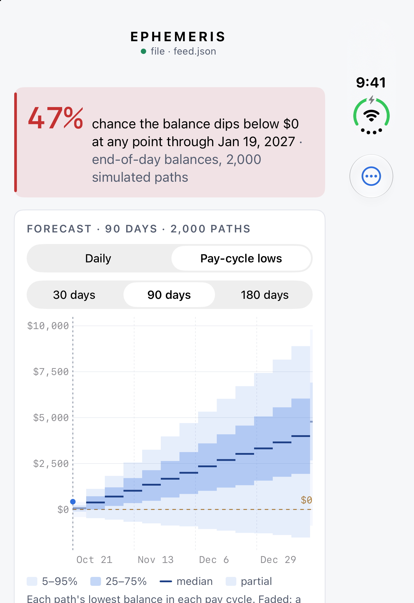
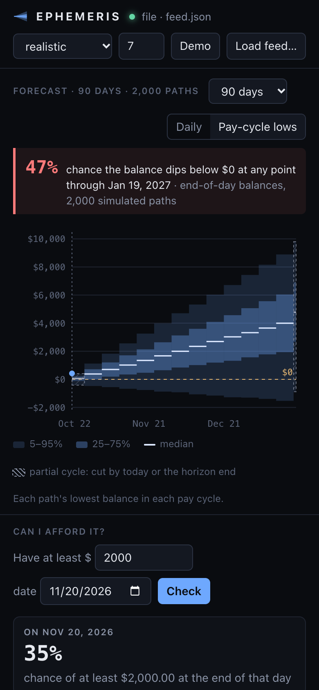

# EPHEMERIS

A personal financial trajectory engine. It estimates your true financial state
with a Kalman filter and projects it forward as a Monte Carlo probability cone,
not a single number. One Rust core, shipped to iOS, Android, Web, and Desktop.

Status: Phase 1 (core engine, CLI) complete; Phase 2 (web, via WASM),
Phase 3a (iOS app, via UniFFI) and Phase 4a (macOS desktop app, via Tauri)
in progress. Full spec: docs/spec.html


*The web app on the Plaid sandbox feed. That feed is Plaid's synthetic test
data with a fake, static balance, so the 47% chance of going below $0 shows
what the feature looks like, not anything about a real account.*

## Desktop app (macOS)

The web UI in a Tauri window, with the engine running natively instead of
in WASM (docs/phase4-design.md). Needs Rust, Node, and `wasm-pack` (used
for type-checking the shared UI).

```sh
cd web && npm ci
npm run tauri -- dev                    # dev window, reloads on changes
npm run tauri -- build --bundles app    # unsigned release .app
open ../target/release/bundle/macos/EPHEMERIS.app
```

## iOS app

A SwiftUI app with the engine linked in natively through UniFFI
(docs/phase3-design.md); simulator only for now, unsigned. Needs Xcode with
an iOS simulator runtime, XcodeGen, and the Rust iOS targets
(`rustup target add aarch64-apple-ios aarch64-apple-ios-sim`).

```sh
scripts/build-ios.sh --sim-only            # engine → ios/EphemerisKit/EphemerisFFI.xcframework
swift test --package-path ios/EphemerisKit # golden, drift and app-model tests, on the Mac
scripts/test-ios.sh                        # the same tests in the simulator, then launches the app
xcodegen generate --spec ios/project.yml && open ios/Ephemeris.xcodeproj
```

<p>
  
  
  
</p>

*The iOS app in the simulator, taken with `scripts/ios-screenshots.sh`:
demo data (dark, daily), then the Plaid sandbox feed (dark, daily; light,
pay-cycle lows). The simulator's only iPhone model is a foldable, so these
are its cover screen, with the status bar down the right edge. As above, the
sandbox feed is synthetic test data with a fake static balance: the 47% shows
the feature, not a finding.*

## Screenshots

Taken with `node scripts/screenshots.mjs --build`. "Demo" is the engine's
own synthetic generator (realistic mode, seed 7); "sandbox" is the Plaid
sandbox feed, synthetic test data with a fake static balance. Neither is a
real account, and the risk figures only demonstrate the feature.


*Demo data: a synthetic account that stays well above $0, with the
payday-and-rent sawtooth.*


*Sandbox data, pay-cycle lows view, light mode. The hatched cycles at each
end are partial.*

<p>
  
  
</p>

*At 390px phone width: demo data in light mode (daily view) and sandbox data
in dark mode (pay-cycle lows).*

## Paper

**When Does Transaction History Beat a State-Space Model? Probabilistic
Balance Forecasting on Sparse Bank Accounts** (Om Raut).

On sparse accounts of the Berka bank data, the state-space forecaster has
lower CRPS than the account's own past balance changes at seven days, while
the empirical forecast wins at 30 and 90 days. Supplying realized future
flows from detected streams improved schedule replacement at 30 days. At 90
days, the oracle variant still scored worse than the empirical forecast
under both aggregations, and the source of the remaining loss is
unresolved.

The paper, its analysis plan and every committed result are in
[`paper/`](paper/). To build the PDF from the committed results:

```sh
scripts/paper.sh --pdf-only     # writes paper/build/latex/main.pdf
```

It needs a TeX distribution with `latexmk` and the Python environment
described at the top of `scripts/paper.sh`.

## Known gaps

Phase 1 is done, with these gaps stated plainly. Details and measurements
are in docs/phase1-design.md and docs/sandbox-comparison.md.

- **The spend rate is floored at $0/day in the forecast.** The filter's `c`
  is Gaussian, so a wide estimate reaches below zero (the Plaid sandbox
  after its regime changes: ±2σ −$5 to $139/day). The forecast samples `c`
  truncated at $0 and reports that range instead ($8.94 to $139.59). A
  user whose discretionary flow really is a net inflow is mis-forecast;
  `ForecastConfig::spend_floor = None` restores the plain Gaussian.
  Measurements: docs/phase1-design.md §7.
- **Irregular income is not income.** Income is the largest *regular*
  inflow, found by fitting a pay schedule. Gig income, commissions, or a
  one-off wages deposit are treated as unexplained inflows (lumps), so the
  forecast has no paychecks for them. One primary income stream only.
- **The first week after a regime change is overconfident.** The change
  detector needs a run of evidence (median 9 days to flag a doubling of
  spending on model-matched data). Until it fires, the cone is narrow
  around the old spend rate: 44% coverage of the 90% interval one week
  after a doubling. A halving of spending is found slowly, and a pay cut
  only at the second short paycheck.
- **The "chance of dipping below $0" is badly over-predicted on real
  data.** On the Berka bank data (the paper's exploratory overdraft-event
  analysis, development split), going below $0 within 7–90 days is rare
  (0.3–1.8% of forecasts on held-out accounts). At 30 and 90 days, no
  method tested beats the account's own historical frequency for it: the
  paper's V2 configuration, a filter-free variant, and two empirical
  competitors. At 7 days, only the empirical path forecast does. V2 never
  does. Every method was too pessimistic about dips. The shipped default (V0) was not tested on
  this event. Treat the probability as a cautious upper estimate, not a
  calibrated one. Details: paper/results/exploratory/s5-overdraft/.
- **The cone's centre is not calibrated on real data.** With the paper's
  selected configuration (V2: sparse spending, an opt-in engine option),
  the 50% band on held-out Berka accounts covers 64–71% of outcomes: it
  is too wide at the centre, while its 90% band holds. The shipped
  default (V0) errs the other way on the same data: its 50% band covers
  about 27% at 30 and 90 days (too narrow). Details: paper/results/heldout/.
- **Real-data validation is thin.** The only real-shaped data is one Plaid
  sandbox item: one checking account, a perfectly flat weekly payroll, two
  monthly streams, static balances (so the reconstructed balance history is
  fictional), and no pending→posted links. Everything else is validated on
  the synthetic generator, which shares the author's assumptions.
